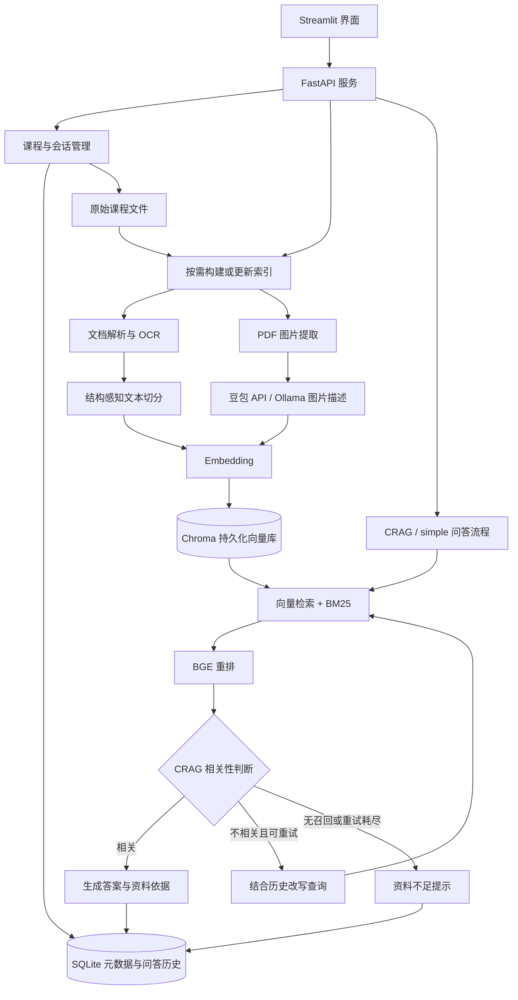

# 课程资料智能问答系统

基于 RAG 的课程资料问答与复习辅助系统。使用 Streamlit 提供交互界面，FastAPI 管理课程、文件和持久化会话，通过混合检索、重排和大模型生成带资料依据的回答。

系统以课程组织知识库，以会话保存资料选择和问答记录，适用于个人课件检索、知识点梳理和复习提纲生成。

## 核心功能

- **课程与会话管理**：不同课程的文件和索引隔离；同一课程可建立多个会话，分别选择资料并保存历史。
- **多格式资料接入**：支持 PDF、DOCX、PPTX、Markdown 和 TXT，单文件上传上限为 200MB。
- **结构感知切分**：识别 Markdown 标题层级，长文本按段落、句子和字符逐级切分，保存来源和章节信息。
- **混合检索与重排**：向量检索和 BM25 合并去重，再使用 BGE Cross-Encoder 筛选相关片段。
- **CRAG 自纠错流程**：判断召回内容的相关性，不相关时结合历史改写查询并重新检索；重试耗尽后返回资料不足提示。
- **PDF 图片理解**：提取内嵌图片，通过豆包 API 或本地视觉模型生成描述，将描述纳入默认 Chroma 检索流程。
- **资料依据展示**：展示召回片段、文件名、页码、章节和关联原图，便于核对回答。
- **持久化与删除管理**：上传后立即保存原始文件；支持删除课程、资料和会话，以及单独清空会话历史。

## 系统架构



图中展示默认的 Chroma 与 CRAG 流程。`simple` 模式跳过相关性判断和查询改写，直接使用重排结果生成答案；FAISS 是可选的文本索引后端。

### 文档处理与索引

上传与建库分离：上传接口保存文件和课程资料目录，首次提问时处理本次选择的资料。

1. 按文件内容计算 SHA-256，判断索引是否已包含该版本的文档。
2. PDF 默认通过 `pymupdf4llm` 转为 Markdown，并对扫描页提供 RapidOCR 补充识别；其他格式归一化为页面文本。
3. 过滤噪声页，切分文本并保留来源、页码及章节路径。
4. 在 Chroma 流程中提取 PDF 内嵌图片，对符合尺寸条件的图片生成中文描述，并构造图片片段。
5. 对文本和图片描述计算向量，写入持久化集合。

Chroma 按 `(source, doc_hash)` 管理文档版本：未变化的文件复用向量，文件变化时替换该文档的向量。Embedding、解析与切分参数、图片后端和描述提示词等参与索引配置指纹；相关配置改变并重启后，下次提问使用新的索引配置。

### 检索与生成

向量检索与 BM25 分别召回候选片段，按 `(source, page, chunk_id)` 合并去重并截取候选集，再由 `BAAI/bge-reranker-base` 统一重排。当前合并方式不是 RRF 或加权分数融合。

默认 CRAG 流程为：

```text
检索与重排 → 相关性判断 → 相关：生成答案
                      → 不相关：改写查询 → 重新检索
                      → 无召回或重试耗尽：返回资料不足提示
```

默认最多改写重试两次。历史对话在查询改写节点使用，正常生成节点使用当前查询和召回资料；当前实现不在每次生成时注入完整历史。

### LangChain 与 LangGraph 的职责

- **LangChain**：通过 `ChatPromptTemplate | ChatModel | StrOutputParser` 组装生成、相关性判断和改写链，统一文字模型的 API / Ollama 调用。
- **LangGraph**：编排 CRAG 的共享状态、条件分支和重试循环。
- **自有检索模块**：负责文档解析、切分、Embedding、混合检索、重排和索引管理，由编排层调用。

## 技术栈

| 层次 | 技术 |
| --- | --- |
| 前端 | Streamlit 1.65+，原生会话组件与主题配置 |
| 后端 | FastAPI、Pydantic、Uvicorn |
| 元数据与历史 | SQLite |
| 向量索引 | Chroma（默认）、FAISS（可选） |
| 文档解析 | PyMuPDF、pymupdf4llm、python-docx、python-pptx |
| OCR | RapidOCR / ONNX Runtime |
| 检索与重排 | Sentence Transformers、BM25、jieba、BGE Cross-Encoder |
| 文字模型编排 | LangChain LCEL、LangGraph |
| 模型服务 | OpenAI-compatible API、Ollama |

## 快速开始

以下命令均在项目根目录执行。建议使用 Python 3.11 的独立环境。

### 1. 安装依赖

```powershell
conda create -n course-rag python=3.11
conda activate course-rag
python -m pip install -r requirements.txt
```

本地 Embedding 与 reranker 首次使用时会加载 Hugging Face 模型，尚未缓存的权重需要下载。CUDA 加速需要当前 Python 环境中的 PyTorch 支持对应 GPU；安装项目依赖不保证自动获得 CUDA 版本。

### 2. 配置模型服务

在项目根目录创建 `.env`：

```dotenv
ZHI_API_KEY=your_api_key
ZHI_BASE_URL=https://api.zhizengzeng.com/v1
```

默认图片理解使用智增增豆包 API，复用这两个变量。文字问答与 Embedding 选择 API 后端时也使用它们。密钥放在 `.env` 中，该文件已被 Git 忽略。

当前文字问答默认使用本地 Ollama。安装并运行 Ollama，准备模型：

```powershell
ollama pull deepseek-r1:8b
ollama list
```

保持 Ollama 客户端的后台服务运行；也可在独立终端中运行 `ollama serve`。默认服务地址为 `http://127.0.0.1:11434`。

如果希望文字问答也使用 API，在 `config.py` 中修改：

```python
LLM_BACKEND = "api"
CHAT_MODEL = "deepseek-chat"
```

模型名称需与智增增账号可用的模型一致。修改配置后重启 FastAPI；模型列表可查阅[智增增文档](https://doc.zhizengzeng.com/doc-3979947)。

### 3. 启动后端

```powershell
python -m uvicorn api.main:app --host 127.0.0.1 --port 8000
```

接口文档：[http://127.0.0.1:8000/docs](http://127.0.0.1:8000/docs)。

### 4. 启动前端

在第二个终端激活同一环境，并进入项目根目录：

```powershell
python -m streamlit run app.py
```

打开 [http://localhost:8501](http://localhost:8501)。前端默认连接 `http://127.0.0.1:8000`；如需更改，在启动前设置环境变量 `RAG_API_BASE_URL`。

### 5. 使用系统

1. 创建课程并上传资料。
2. 创建会话，选择该会话使用的资料。
3. 输入问题，首次提问会按需建库。
4. 查看回答和召回依据，核对原文或图表。
5. 再次打开页面时选择已有课程和会话，继续使用已保存的数据。

可尝试：“总结这些课件的核心知识点”“解释某个概念并给出页码”“根据资料整理复习提纲”。

## 模型与流程配置

主要配置集中在 `config.py`，图片、文字和 Embedding 后端独立选择。

| 配置项 | 当前默认值 | 用途 |
| --- | --- | --- |
| `LLM_BACKEND` | `"ollama"` | 文字生成、CRAG 判断与改写；可改为 `"api"` |
| `OLLAMA_MODEL` | `"deepseek-r1:8b"` | 本地文字模型 |
| `CHAT_MODEL` | `"deepseek-chat"` | 在线文字模型 |
| `VLM_BACKEND` | `"api"` | 图片描述；可改为 `"ollama"` |
| `VLM_API_MODEL` | `"doubao-seed-2-0-mini-260215"` | 默认豆包图片模型 |
| `VLM_MODEL` | `"qwen2.5vl:7b"` | 本地图片模型 |
| `VLM_MAX_TOKENS` | `512` | API 图片描述输出上限，豆包关闭深度思考 |
| `EMBEDDING_BACKEND` | `"hf"` | 本地向量化；可改为 `"api"` |
| `HF_EMBEDDING_MODEL` | `"BAAI/bge-small-zh-v1.5"` | 本地中文 Embedding |
| `EMBEDDING_MODEL` | `"text-embedding-3-small"` | API Embedding |
| `VECTOR_STORE_BACKEND` | `"chroma"` | 向量索引；可改为 `"faiss"` |
| `RAG_FLOW` | `"crag"` | 自纠错流程；可改为 `"simple"` |
| `MAX_RETRIEVE_RETRIES` | `2` | 不相关时的最大改写次数 |
| `MAX_HISTORY_TURNS` | `3` | 改写节点使用的最近历史轮数 |
| `PDF_PARSE_BACKEND` | `"markdown"` | PDF 解析；可改为 `"text"` |
| `CHUNK_SIZE` / `CHUNK_OVERLAP` | `700` / `150` | 文本切分字符参数，不是 Token 数 |
| `VECTOR_TOP_K` / `BM25_TOP_K` | `8` / `8` | 两路召回数量 |
| `FINAL_TOP_K` / `RERANK_TOP_K` | `12` / `5` | 合并候选数与重排后片段数 |
| `OCR_ENABLED` | `True` | 扫描页 OCR 路由 |
| `IMAGE_EXTRACT_ENABLED` / `VLM_ENABLED` | `True` / `True` | PDF 图片提取与描述 |

Reranker 当前固定使用 `BAAI/bge-reranker-base`，模型名称位于 `modules/reranker.py`。本地 Embedding 与 reranker 自动选择 CUDA（可用时）或 CPU。

如需完全本地处理图片，将 `VLM_BACKEND` 设为 `"ollama"`，并运行 `ollama pull qwen2.5vl:7b`。API 图片模式会把提取的图片发送到配置的服务；API 文字模式会发送查询和召回上下文。

## 数据存储与隔离

```text
data/
└── courses/<course_id>/<filename>       原始课程文件
storage/
├── workspace.db                        课程、资料目录、会话、资料选择、问答结果
├── courses/<course_id>/
│   ├── registry.db                     文档内容哈希与登记信息
│   ├── chroma/                         Chroma 持久化数据库
│   └── <kb_id>/                        可选 FAISS 索引与 metadata.pkl
└── images/<doc_hash>/                  PDF 原图缓存
```

目录按需创建，路径相对于项目启动工作目录。备份时应同时保留 `data/` 与 `storage/`。

不同课程的同名文件、注册表和索引隔离；同一课程的会话共用资料库，分别保存资料选择与历史。向量查询和 BM25 候选均限制在当前选择的文件内。会话问答由后端读取历史，Streamlit `session_state` 只保存临时界面状态。

| 操作 | 数据影响 |
| --- | --- |
| 清空会话历史 | 删除该会话的问答记录，保留会话和课程资料 |
| 删除会话 | 删除会话及其问答记录，保留课程资料 |
| 删除资料 | 删除原始文件、登记记录及对应 Chroma 向量，清理 FAISS 与检索缓存，并更新各会话的资料选择 |
| 删除课程 | 删除课程、原始资料、全部会话和对应检索数据 |

删除资料后保留历史回答，其召回依据标记为“资料已删除”，关联原图不再展示。图片缓存按内容哈希共享，删除资料不会直接删除共享图片目录；清理 Chroma 集合后，数据库目录可能仍保留引擎内部结构。

## API

完整请求和响应结构以运行中的 `/docs` 为准。

| 方法 | 路径 | 用途 |
| --- | --- | --- |
| GET | `/health` | FastAPI 存活检查 |
| GET / POST | `/courses` | 查看 / 创建课程 |
| DELETE | `/courses/{course_id}` | 删除课程及其数据 |
| GET | `/courses/{course_id}/documents` | 查看课程资料 |
| PUT | `/courses/{course_id}/documents/{filename}` | 上传原始二进制文件，不使用 multipart |
| DELETE | `/courses/{course_id}/documents/{filename}` | 删除资料并清理检索数据 |
| GET / POST | `/courses/{course_id}/sessions` | 查看 / 创建会话 |
| GET | `/sessions/{session_id}` | 获取会话及完整问答记录 |
| PATCH | `/sessions/{session_id}/documents` | 保存资料选择，请求体为 `{"doc_names": [...]}` |
| DELETE | `/sessions/{session_id}/turns` | 清空会话历史 |
| DELETE | `/sessions/{session_id}` | 删除会话 |
| POST | `/chat` | 建库或加载索引并执行问答 |

推荐通过持久化会话调用 `/chat`：

```json
{
  "session_id": "your_session_id",
  "question": "请解释资料中的核心概念，并说明对应页码。",
  "top_k": 5
}
```

可通过 `doc_names` 覆盖本次资料选择。携带 `session_id` 时使用后端历史；未初始化资料选择时默认使用该课程的全部资料，显式空列表不参与问答。返回包含 `answer`、`retrieved_chunks` 与流程信息，CRAG 还返回 `original_question`、`retries` 和 `fallback`。

旧版不带 `session_id` 的 `doc_names` / `pdf_names` 调用仍兼容，读取 `data/` 根目录文件，不写入课程会话历史。

## 项目结构

```text
course_rag_system/
├── api/main.py                  FastAPI 接口与索引生命周期管理
├── app.py                       Streamlit 界面
├── config.py                    模型、切分与检索配置
├── .streamlit/config.toml       界面主题
├── modules/
│   ├── api_client.py            前端 HTTP 客户端
│   ├── workspace_store.py       课程、文件、会话与历史持久化
│   ├── doc_registry.py          文件内容哈希登记
│   ├── document_loader.py       多格式文档接入
│   ├── pdf_loader.py            PDF Markdown / 文本解析
│   ├── ocr_router.py            扫描页识别与 OCR
│   ├── data_cleaner.py          噪声页过滤
│   ├── text_splitter.py         结构感知切分
│   ├── image_extractor.py       PDF 图片提取
│   ├── vlm_captioner.py         API / Ollama 图片描述
│   ├── embeddings.py            本地 / API 向量化
│   ├── chroma_store.py          Chroma 持久化与文件过滤
│   ├── vector_store.py          FAISS 保存、加载与检索
│   ├── bm25_retriever.py        中文 BM25 检索
│   ├── hybrid_retriever.py      两路召回与合并去重
│   ├── reranker.py              BGE 重排
│   ├── llm_backends.py          LangChain 文字模型链与错误边界
│   ├── rag_chain.py             上下文构造与 simple 问答
│   └── rag_graph.py             LangGraph CRAG 状态图
├── tests/                       自动化回归测试
├── requirements.txt
└── README.md
```

## 测试

```powershell
python -m pytest -q
```

测试覆盖文档解析、切分、OCR 路由、图片提取与 VLM 请求、向量库、混合检索、模型链、CRAG 分支、课程隔离、持久化会话和删除操作。模型调用使用伪模型或模拟响应，不依赖真实 API 密钥和 Ollama 推理服务。

如果系统临时目录权限受限，可指定项目内的新临时目录：

```powershell
python -m pytest -q --basetemp=.pytest_tmp/readme-check
```

## 常见问题

**首次提问较慢。** 首次提问可能包含模型下载与加载、OCR、图片描述、向量化和索引构建。后续命中索引时省去文档处理；CRAG 仍需要相关性判断等额外模型调用。可切换 `RAG_FLOW = "simple"` 减少调用，但会关闭自纠错流程。

**CPU 占用高，GPU 占用不明显。** 解析、分词、BM25 和默认 OCR 等环节可能在 CPU 上执行。本地 Embedding 与 reranker 的设备以终端日志为准；可用 `python -c "import torch; print(torch.cuda.is_available())"` 检查当前环境，用 `ollama ps` 查看正在运行的 Ollama 模型分配。

**文字模型无法连接或超时。** 连接失败返回 HTTP 503，超时返回 HTTP 504，并提供可读的 `detail`。本地模式检查 Ollama 服务、模型及地址，API 模式检查密钥、地址和网络。失败请求不写入问答记录。`/health` 只检查 FastAPI 在线，不检查模型依赖。

**图片描述失败。** 查看终端 VLM 告警，检查模型 ID、密钥权限、余额和服务状态。图片失败不阻断文本建库，但当前没有失败图片自动补库机制；修复服务后可删除并重新上传该资料。删除资料会移除其原文件与索引，历史回答仍保留。

## 当前边界

- 面向个人单用户使用，尚未实现账号、鉴权和多租户权限；课程隔离是数据组织隔离。
- 课程内操作由单进程锁协调，当前运行方式使用一个 Uvicorn worker；尚未提供跨进程任务锁或后台建库队列。
- 图片理解通过“图片 → 描述文本 → 向量检索”实现，不是原生图片向量检索；当前仅处理 PDF 内嵌图片，并仅接入 Chroma 建库流程。
- PDF 使用实际页码，PPTX 使用幻灯片序号；DOCX、Markdown 和 TXT 无分页映射，统一标记为第 1 页。
- 切分采用结构规则和字符长度，未实现基于 Embedding 的语义边界检测。混合召回目前没有 RRF 融合。
- 生成提示词要求引用资料，前端展示召回依据；尚未实现答案引用的自动逐条校验、系统化质量评测或流式输出。
- FAISS 是独立可选后端，不会在 Chroma 故障时自动切换。
